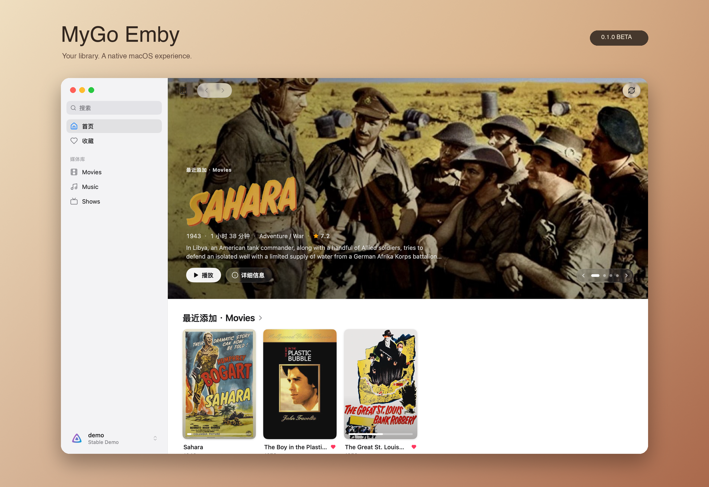

# MyGo Emby

用 Go 和 [MyGo](https://github.com/egoist/mygo) 构建的 Emby / Jellyfin 桌面客户端，让媒体库融入 macOS 的日常体验。



> **当前为 0.1.0 测试版。** 主要在 macOS 上开发与验证，播放兼容性、字幕和交互仍在完善；暂不承诺其他平台的完整体验。

## 功能

- **媒体库浏览**：首页推荐、继续观看、接下来观看、最近添加、海报网格和详情页。
- **找到想看的内容**：搜索、收藏、排序、已看标记、剧集与分集浏览。
- **多服务器登录**：保存多个账户并切换，支持 Emby 与 Jellyfin；当前主要围绕 Emby 验证。
- **播放器**：进度拖动、倍速、音轨与字幕选择、全屏、断点续播与下一集。
- **本机转封装**：支持的 MKV、TS、hev1 MP4 组合可转成 fMP4 HLS，视频不重新编码。
- **macOS 原生视频输出**：通过 AVPlayerLayer 播放；HDR / Dolby Vision 效果取决于片源、封装、系统及显示设备。
- **原生 UI**：使用 MyGo 的 Go UI 渲染路径，无 WebView；浅色、深色与系统主题，可折叠侧边栏。

## 运行与构建

需要 macOS、Go **1.27.4 或更新版本**，以及你有权访问的媒体服务器。

```sh
git clone https://github.com/may3rr/MyGo-Emby.git
cd MyGo-Emby
go run .
```

```sh
go tool mygo dev                       # 开发模式
go tool mygo build                     # 构建应用与 DMG
CGO_ENABLED=0 go test ./...             # 测试
go tool mygo vet .                     # UI 生命周期检查
```

仓库包含带局部补丁的 `vendor/`，请保留并使用它；直接运行 `go mod vendor` 会覆盖原生视频相关修改。详见 [原生视频实现](docs/native-video.md)。

部分不兼容音轨需要本机 FFmpeg 转成 AAC；仅在需要时调用。未安装时会提示，视频仍保持原编码。可使用 `brew install ffmpeg` 安装。

## 测试版已知限制

- 兼容性受服务器 API、媒体源和音视频编码影响，不能保证所有文件都能播放。
- 图形字幕（如 PGS、VobSub）需要服务器烧录能力；没有该能力时存在限制。
- HDR、Dolby Vision 与复杂字幕仍需更多设备、片源验证。
- 尚未发布正式稳定版安装包；当前可从源码运行。

更多说明：[媒体兼容性](docs/media-compatibility.md) · [侧边栏](docs/sidebar.md)。

## 截图与宣传素材

宣传图中的界面来自应用实际运行时的截图，内容为公开 Jellyfin 演示库。背景由 NumPy 绘制，圆角、阴影与红绿灯由 Pillow 合成，**未使用生图模型**。系统窗口装饰不在内容截图内，因此在宣传排版中补绘；[原始截图](docs/assets/home.png)单独保留。

```sh
EMBY_SHOTS=build/release/shots EMBY_SHOTS_DARK=0 go run .
```

上述命令使用公开演示服务器；自有服务器可通过 `EMBY_SHOTS_SERVER`、`EMBY_SHOTS_USER`、`EMBY_SHOTS_PASS` 环境变量提供。截图发布前请检查账户、服务器和媒体信息。

重新生成宣传图（macOS 系统字体）：

```sh
python3 -m venv build/promo-venv
build/promo-venv/bin/pip install numpy pillow
build/promo-venv/bin/python scripts/make_promo.py
```

## 隐私与反馈

访问令牌通过系统凭据存储保存；本地设置仍包含服务器地址、账户显示信息等元数据。请勿提交真实配置、令牌、密码或带鉴权参数的 URL。反馈时提供操作步骤、服务器版本、媒体容器与编码，并先脱敏日志和截图。

## 致敬与感谢

- [MyGo / egoist](https://github.com/egoist/mygo)：本项目的 UI 与桌面框架基础，感谢它让 Go 原生桌面应用成为现实。
- [qEmby / AlanHJ](https://github.com/AlanHJ/qEmby)：感谢它在 Emby 客户端功能与观影体验上的探索，为本项目提供了参考和灵感。

MyGo Emby 是独立实验项目，与上述项目及 Emby、Jellyfin 无官方隶属关系。截图中媒体海报与剧照的权利归各自权利人，应用不提供媒体资源。

目前尚未为本项目代码指定开源许可证；第三方依赖保留各自的许可证与声明。
